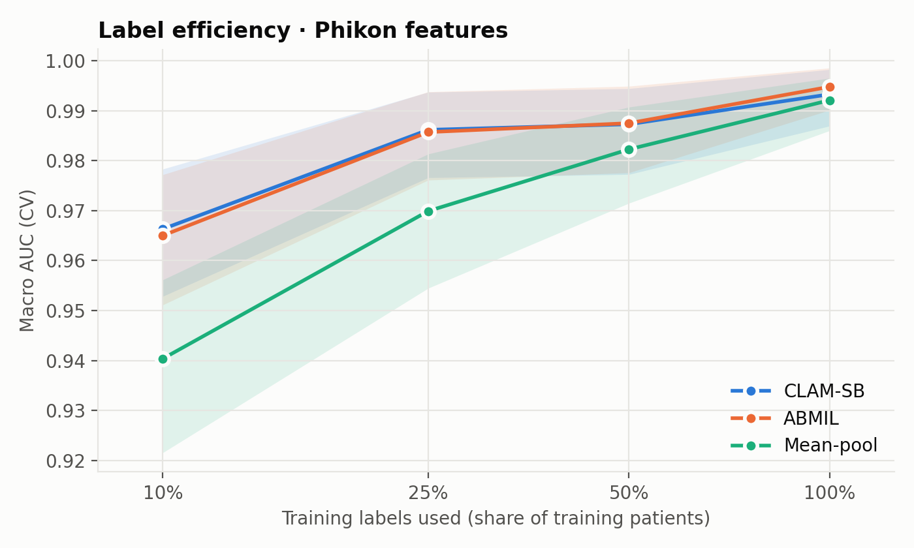
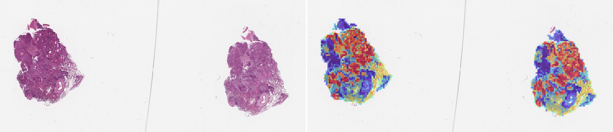

# lung-clam

Weakly supervised **Normal / LUAD / LUSC** classification of lung whole-slide images with
[CLAM](https://github.com/mahmoodlab/CLAM). It's built to be honest about what the model learns, and to run on a laptop plus a free Colab GPU.

> 🚧 Cross-validation and external-test results are in ([Results](#results)); the sealed internal test is still to come. See [ROADMAP.md](ROADMAP.md).
> ⚠️ Research and education only. Not a medical device, and not for clinical use.

<p align="center"><a href="https://colab.research.google.com/github/amaansayydd/lung-clam/blob/main/notebooks/lung_clam_colab.ipynb"></a></p>

## What's different about this project

| | Typical CLAM tutorial | This project |
|---|---|---|
| Normal class | TCGA normals (frozen sections) vs tumour (FFPE) → the model can learn the *preparation*, not the cancer | CPTAC normal-adjacent slides **from the same patients** as the tumour slides, same preparation and scanner |
| Splits | by slide | by **patient**, plus a sealed internal test set and a 68-hospital **external** test (TCGA) |
| Encoder | ImageNet ResNet50 | ResNet50 **vs** a pathology foundation model (Phikon), same splits |
| What CLAM adds | not measured | CLAM-SB vs CLAM-MB vs ABMIL vs max- vs mean-pooling, and **label-efficiency** curves (10–100% of labels) |
| Shortcuts | not checked | a "shortcut detector" trained on colour and size only. If it scores well, the data leaks |
| Uncertainty | single number | 95% CIs from a patient-level bootstrap |

## Data

| Set | Source | Slides | Patients | Role |
|---|---|---|---|---|
| CPTAC LUAD / LUSC / Normal | [NCI Imaging Data Commons](https://portal.imaging.datacommons.cancer.gov/) (CPTAC-LUAD, CPTAC-LSCC) | 150 / 150 / 150 | 300 | 5-fold CV (240 patients) + sealed internal test (60 patients) |
| TCGA LUAD / LUSC (FFPE diagnostic) | [GDC](https://portal.gdc.cancer.gov/) original Aperio `.svs` (IDC's TCGA copies are JPEG 2000 DICOM, which OpenSlide can't read) | 60 / 60 | 120, 68 hospitals | external test |

The list of slides is fixed in [`manifests/slides.csv`](manifests/slides.csv), built by [`scripts/01_build_manifest.py`](scripts/01_build_manifest.py) with seed 42. Findings about the data are in [`docs/data_findings.md`](docs/data_findings.md).

## Pipeline

```
IDC (cloud) ──▶ download one slide ──▶ tissue segmentation (CLAM) ──▶ 128 µm patch grid
            ──▶ ResNet50 + Phikon features (fp16) ──▶ QC thumbnail + slide stats ──▶ delete slide
features ──▶ CLAM / baselines (5 patient-level folds) ──▶ metrics + bootstrap CIs ──▶ heatmaps
```

- **Streaming:** raw slides are only on disk while they're processed, so the 262 GB dataset needs a few GB of local disk (features: ~12 GB for 3.1M patches).
- **Resolution-independent patches:** every patch covers 128 µm whatever the scan resolution (256 px at 20×, 512 px at 40×), resized to 224 px on the GPU.
- **Resumable:** each step skips work whose output already exists.

## Running it

### On Google Colab (recommended for the heavy steps)

Open [`notebooks/lung_clam_colab.ipynb`](https://colab.research.google.com/github/amaansayydd/lung-clam/blob/main/notebooks/lung_clam_colab.ipynb) in Colab, select a **T4 GPU**, and choose **Run all**. It stores about 12 GB in Google Drive (about 18 GB with UNI) and continues where it stopped if Colab disconnects.

### Locally (macOS with Apple Silicon, or Linux)

Requires git and [uv](https://docs.astral.sh/uv/).

```bash
git clone --recurse-submodules https://github.com/amaansayydd/lung-clam.git
cd lung-clam
bash scripts/setup.sh                                 # CLAM + patches + Python 3.10 env + self-check
uv run python scripts/run_stream.py --pilot           # 30 pilot slides end to end
uv run python scripts/run_experiments.py core         # train
uv run python scripts/30_evaluate.py                  # tables → results/tables/
uv run python scripts/60_figures.py                   # figures → results/figures/
uv run python scripts/50_heatmaps.py clam_sb_phikon   # heatmaps → results/heatmaps/
uv run --group dev pytest                             # patient-leakage tests
```

| Script | Does |
|---|---|
| `00_explore_idc.py` | inventory of lung slides in IDC |
| `01_build_manifest.py` | choose the 570 slides (one per patient per class) |
| `run_stream.py` | download → segment → patch → features → QC → delete |
| `10_make_splits.py` | sealed test set + 5 patient-level folds + nested label fractions |
| `20_train.py` | one experiment (YAML in `configs/experiments/`), all folds |
| `run_experiments.py` | groups of experiments (`core`, `ablations`, `label_efficiency`) |
| `30_evaluate.py` | CV / verified-only / external / (once) internal-test tables with 95% CIs |
| `40_shortcut_baseline.py` | colour-and-size-only classifiers on the same folds |
| `50_heatmaps.py` | attention heatmaps + top-patch galleries |
| `60_figures.py` | README figures |

## Results

All numbers below come from the prediction files committed under [`results/runs/`](results/runs) via [`scripts/30_evaluate.py`](scripts/30_evaluate.py) (full table: [`results/tables/metrics.md`](results/tables/metrics.md)). Brackets are 95% CIs from a patient-level bootstrap. Features: Phikon.

**In one sentence:** with all labels every MIL model is near-perfect on CPTAC, but the attention models (CLAM, ABMIL) need far fewer labels and are the ones that still work on another hospital's slides.

### Cross-validation: CPTAC, 360 slides, 5 patient-level folds

| Model | Macro AUC | Balanced acc. | Tumour sensitivity | Normal specificity | LUAD vs LUSC AUC |
|---|---|---|---|---|---|
| CLAM-SB | 0.993 (0.987–0.998) | 0.958 | 1.000 | 0.992 | 0.988 |
| CLAM-MB | 0.993 (0.987–0.997) | 0.953 | 1.000 | 0.992 | 0.981 |
| ABMIL (CLAM without instance clustering) | 0.995 (0.990–0.999) | 0.964 | 1.000 | 0.992 | 0.989 |
| Max-pool MIL | 0.982 (0.970–0.992) | 0.958 | 0.988 | 0.992 | 0.978 |
| Mean-pool | 0.992 (0.986–0.997) | 0.939 | 0.988 | 0.992 | 0.980 |
| *Shortcut detector (colour + size only)* | *0.909 (0.886–0.931)* | *0.775* | *0.950* | *0.850* | *0.843* |

### External test: TCGA, 120 slides from other hospitals, never used for training

TCGA has no matched normal slides here, so the external test is tumour detection and LUAD vs LUSC. Each slide is scored by the 5 fold models.

| Model | LUAD vs LUSC AUC | LUAD vs LUSC balanced acc. | Tumour sensitivity |
|---|---|---|---|
| CLAM-SB | 0.981 (0.958–0.997) | 0.883 | 0.975 (0.942–1.000) |
| CLAM-MB | 0.982 (0.962–0.996) | 0.917 | 0.967 (0.933–0.992) |
| ABMIL | 0.983 (0.962–0.997) | 0.933 | 0.983 (0.958–1.000) |
| Max-pool MIL | 0.983 (0.963–0.996) | 0.925 | 0.950 (0.908–0.983) |
| Mean-pool | 0.951 (0.914–0.980) | 0.850 | **0.800 (0.725–0.867)** |
| *Shortcut detector* | *0.627 (0.515–0.725)* | *0.508* | *—* |

### Label efficiency

<p align="center"></p>

| LUAD vs LUSC AUC | 10% labels | 25% | 50% | 100% |
|---|---|---|---|---|
| CLAM-SB, CV | 0.912 | 0.965 | 0.972 | 0.988 |
| Mean-pool, CV | 0.848 | 0.921 | 0.954 | 0.980 |
| CLAM-SB, TCGA | 0.936 | 0.976 | 0.984 | 0.981 |
| Mean-pool, TCGA | 0.892 | 0.936 | 0.941 | 0.951 |

### What this shows

1. **Attention matters for label efficiency and for transfer, not for in-distribution accuracy.** With all labels, mean-pooling Phikon features is within 0.001 macro AUC of CLAM-SB. With 10% of the labels CLAM leads by 0.06 LUAD-vs-LUSC AUC, and on TCGA mean-pool calls 1 in 5 tumours normal (sensitivity 0.80 vs 0.975).
2. **CLAM's instance clustering adds nothing measurable here.** ABMIL, which is CLAM-SB with clustering switched off, matches it within ±0.01 AUC at every label fraction, in CV and on TCGA. With a strong pathology encoder the extra supervision seems redundant.
3. **The CPTAC data does carry a colour/size signal**, which reaches 0.91 macro AUC in CV. It does not transfer: on TCGA it falls to 0.63, while the MIL models stay at 0.98. They are not relying on it.
4. **Tumour vs normal is easy; LUAD vs LUSC is where models differ.** Every model separates tumour from normal at AUC ≥ 0.995 in CV.

### Attention heatmaps

<p align="center"></p>

CLAM-SB attention on a CPTAC LUSC slide, scored by the fold model that never saw it (red = high attention). More, including every misclassified slide: [`results/heatmaps/clam_sb_phikon/`](results/heatmaps/clam_sb_phikon) (index in `index.csv`).

### Still to come

- **Sealed internal test** (60 patients): the pre-registered final model, CLAM-SB on Phikon with 3 seeds, is scored on it once, at the end.
- ResNet50 (ImageNet) vs Phikon on the same splits, and UNI2-h features.

## Changes to CLAM

CLAM is a pinned git submodule. Our changes are kept in [`patches/0001-apple-mps-and-fp16-features.patch`](patches/0001-apple-mps-and-fp16-features.patch):
- The device is chosen as `cuda → mps → cpu`, and the hard-coded `.cuda()` calls are replaced.
- smooth-topk's SVM losses are rebuilt after moving them to a device. They capture their label buffer when built, which breaks on MPS.
- Checkpoints load with `map_location`, and fp16 feature files load as fp32.
- Labels are mapped in one vectorized step. CLAM's cell-by-cell assignment fails on pandas 3.

On top of CLAM, this repo adds a mean-pooling baseline, a multi-encoder streaming extractor, and the evaluation code. For the 3-class task CLAM runs with `subtyping=False`: tumour slides contain normal tissue, so the "subtyping" out-of-class instance loss would push the wrong way.

## Citations

- Lu, M.Y. et al. *Data-efficient and weakly supervised computational pathology on whole-slide images.* Nature Biomedical Engineering 5, 555–570 (2021).
- Filiot, A. et al. *Scaling self-supervised learning for histopathology with masked image modeling* (Phikon), medRxiv (2023).
- Fedorov, A. et al. *National Cancer Institute Imaging Data Commons.* RadioGraphics 43(12) (2023).
- Clinical Proteomic Tumor Analysis Consortium (CPTAC) LUAD and LSCC collections; The Cancer Genome Atlas (TCGA) LUAD and LUSC.

## License

GPL-3.0, inherited from CLAM. The slide data stays with its sources and is not redistributed here.
